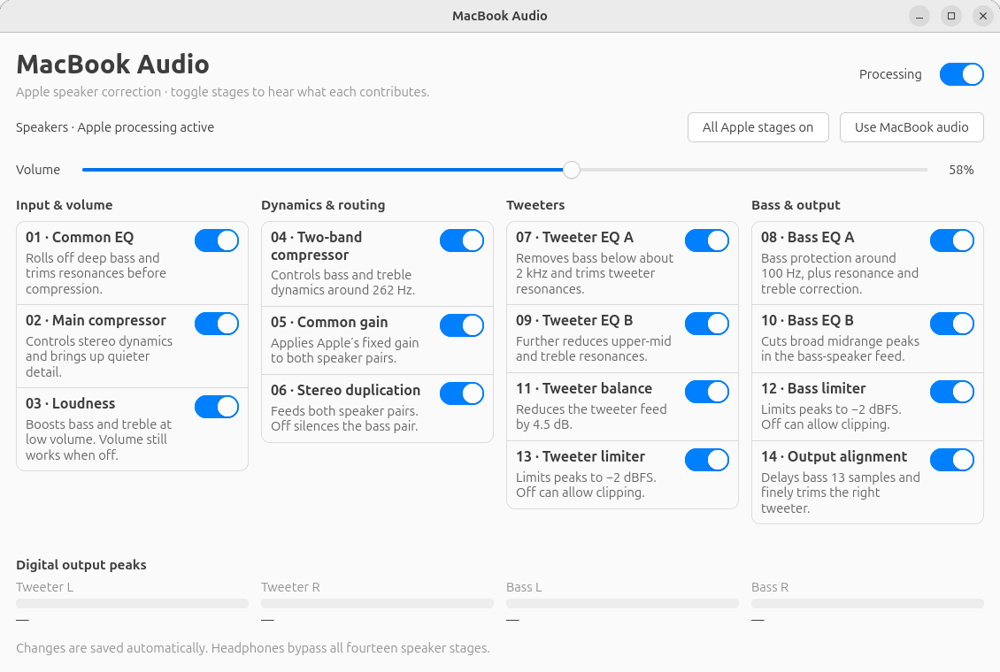

# MacBook Audio

Reconstructed speaker processing for the **MacBook Pro Retina 13-inch,
MacBookPro10,2 / A1425**, running on Linux with PipeWire. A native GTK panel lets
you switch each of the fourteen stages live and explains what it does.

The selected High Sierra Apple DSP graph runs as a native C LV2 plugin in a
separate PipeWire process. Tweeters and bass speakers have independent stereo
feeds. Headphone routing bypasses the speaker correction automatically.

**Experimental, one model and one profile, 48 kHz only.** This is the complete
selected DSP graph; replacement-speaker acoustics and all macOS driver behavior
have not been reproduced or measured. The existing installation is working.
A fresh installation on another machine is not automated yet.



```text
Applications → EasyEffects (Flat, optional) → MacBook Audio virtual sink
                                            │
                                 common EQ, dynamics, volume
                                            │
                              ┌─────────────┴─────────────┐
                         tweeter processing          bass processing
                              │                           │
                            FL / FR                     RL / RR
                              └─────────────┬─────────────┘
                                    ALSA four-channel PCM
```

EasyEffects is an upstream processor in the current installation. The Apple
stages run in our plugin; bypass them with **Processing** in the MacBook Audio
panel. Changes persist, and switches fade over 20 ms without rebuilding the
audio graph or replacing application streams.

## Build and check

Requires Linux, Python 3.10+, a C99 compiler and libm. The LV2 core header is
vendored under its original ISC license. No LV2 development package is needed.

Apple binaries and extracted coefficient data are **not included**. Put your
locally generated `compressor-data.h` and `stack-data.h` into ignored `data/`,
or import them from an existing local reconstruction:

```sh
python3 tools/import_data.py /path/to/generated-headers
python3 tools/build.py
python3 -m unittest discover -s tests -p 'test_*.py'
python3 tests/check_plugin.py
```

The bundle is `build/macbook-apple-stack.lv2/`. Building and checking never
install it or change the running audio setup. `CC`, `--cc`, `--data-dir` and
`--output` are supported. Floating-point reassociation / fast math must stay
disabled to preserve the reference arithmetic.

See [data inputs](data/README.md) for the private extraction workflow and
[validation](docs/validation.md) for reference tests. A clone without local
coefficient data can run the Python checks, but cannot build the real DSP.

## Use the existing installation

Open **MacBook Audio** from the application menu, or run `macbook-audio`.
The panel provides a master bypass, fourteen switches, short explanations,
system volume and four digital output peak meters.

```sh
macbook-eq status
macbook-eq on
macbook-eq off
macbook-eq stage 3 off   # two-band compressor; CLI uses source indices 0–13
macbook-eq stage 3 on
macbook-eq all-on
```

The panel labels stages 01–14. Headphones retain normal volume and receive
front stereo only. Physical jack insertion remains to be checked; explicit
headphone and speaker route changes passed.

Listening volume belongs inside the DSP, before the two-band compressor.
Hardware mixer gains stay at **0 dB**. Set volume on the MacBook Audio virtual
sink, rather than on the physical four-channel output. Read
[operation and recovery](docs/operations.md) before changing the integration.

## Repository

| Directory | Contents |
|---|---|
| `src/` | C DSP core and LV2 wrapper |
| `app/` | GTK4 panel, settings and route controller |
| `config/systemd/` | User service templates for the default XDG paths |
| `tools/` | Build and local-data import tools |
| `tools/research/` | Offline emulation, data generation and numerical checks |
| `tests/` | Routing invariants and an offline LV2 interface check |
| `docs/` | Architecture, validation, operation and provenance |
| `third_party/lv2/` | ISC-licensed LV2 core header and license |
| `data/`, `build/`, `.private/` | Local inputs, outputs and research; excluded from Git |

The earlier experiments and one-off migration / rollback scripts are preserved
locally in `.private/workshop/`. They are historical tools, not a supported
installer. The running installation has independent copies in the user's data
directory; the repository can be moved without stopping sound.

## License and provenance

Our code and documentation are **GPL-3.0-only**, copyright 2026 Thibaud Poncin.
See [LICENSE](LICENSE). `third_party/lv2/` retains its ISC license.

Apple materials and locally extracted data have separate provenance and are
excluded from this repository. The GPL grant for our code does not grant rights
to those materials. No compiled DSP bundles are committed. See
[provenance](docs/provenance.md) for the source fingerprint and boundaries.

## Before a public release

The next release work is a reproducible input-preparation recipe and a fresh
installer with uninstall / recovery, then physical jack and reboot testing.
Distribution of any generated datasets or binary packages needs its own review.
The current repository is a source-only preparation for that release.
